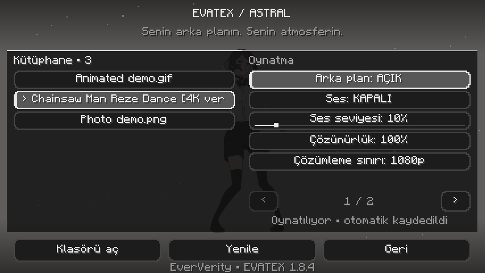

# EVATEX-Background — Astral 1.8.17

Replace Minecraft's title screen, multiplayer server selection, world selection, resource packs and supported main-menu options backgrounds with a video, looping GIF or photo. Made by EverVerity.

**Add a file to `videos` or `backgrounds`, open Backgrounds, select it.**

[Watch the official showcase](https://youtube.com/shorts/EzglUlDrTkI).



## Store and My Library

Open **Backgrounds → Store**, choose a background, select **Download**, then **Apply**. The catalogue has **254 entries: 238 photos, 12 animated GIFs and 4 MP4 videos**, including 13 offline EVATEX originals. Anime, space, nature, gaming and minimal categories, search and favourites help you browse. Downloaded items appear in **My Library** and show **Downloaded / Apply** in the store.

My Library also shows cached covers for your own photos, GIFs and videos. Video covers are silent, single-frame posters generated one at a time; cards do not run multiple video players. Astral navigation, subtle transitions and an original soft click sound keep the interface consistent. UI clicks follow Minecraft's own sound controls independently of wallpaper audio.

Online covers load automatically and can be disabled in Store. Cached covers and the bundled catalogue remain available offline; uncached external downloads require a connection. **Refresh** retrieves the small public catalogue without a new mod download. External files download directly from pinned public source collections or credited NASA/Goddard media into the game directory, with exact-size and Git blob or SHA-256 checks. Media is not bundled, mirrored or relicensed by EVATEX; original artist rights apply. The collection is mostly static images, not 254 animated videos.

## Optional in-game settings backgrounds

In EVATEX settings → Menus, **In-game options background** is off by default. Enable it to use your wallpaper in supported options screens while a world is loaded. This does not play video behind ordinary gameplay, chat or inventories. Leaving a supported menu closes the decoder and audio processes and releases the video texture. Existing title-menu settings remain independent. Video playback still has a hardware-dependent cost while an opted-in menu is open.

## Backgrounds and Windows playback

Photos are decoded once; the decoder then exits while the texture remains visible. Animated GIFs loop at their source timing, sampled at the configured presentation frame rate. PNG/JPEG/BMP are treated as static photos; animated PNG/WebP are not advertised as supported.

The production frame pipeline reuses a bounded pool and a persistent render staging buffer instead of allocating a full pixel array every frame. Windows transports decoded pixels over a buffered loopback TCP connection to avoid small anonymous-process-pipe buffers. Video and PCM uploads bind only to `127.0.0.1` on ephemeral ports. Each upload uses a fresh 256-bit secret in a bounded HTTP handshake; unauthorized or incomplete handshakes are rejected, and the listener closes after the authenticated connection. Decoder shutdown closes active streams. This prevents unauthenticated local clients from supplying frames; it is not protection against a process that can inspect the same user's process arguments or memory.

EVATEX requests D3D11 hardware video decoding and GPU downscaling on Windows. Unsupported drivers/codecs fall back to hardware decoding without GPU scaling, then software decoding. Linux and macOS retain their existing decoder selection. Video size, frame-rate and audio settings are preserved.

The log records `EVATEX video decoder active: D3D11_SCALE`, `D3D11` or `SOFTWARE` after actual frames arrive. GPU work appears in Windows Task Manager's **Video Decode** graph; the **3D** graph alone does not measure video decoding. If a driver causes trouble, set `hardwareAcceleration` to `false` in `config/evatexbackgroundvideo.json` while the game is closed.

GPU decoding still involves CPU colour conversion, frame copies, audio and Minecraft rendering. Performance depends on the source and hardware. See [validation records](VALIDATION.md) for tested configurations and remaining platform limits.

## Installation


EVATEX has native **Forge** and **NeoForge** builds alongside Fabric. The release list shows the available Minecraft/loader combinations; **1.21.11** is the modern runtime-tested reference, and the historical Forge **1.20.1** development client also passed representative menu tests. Choose the jar matching both your loader and Minecraft version; install only one EVATEX jar in an instance. Forge/NeoForge builds use their native Mods settings button and include the same backgrounds, sound controls and optional Astral interface. They do not require Fabric API, Mod Menu or a compatibility bridge.

| Loader | Minecraft | Minimum loader | Java |
| --- | --- | --- | --- |
| Forge | 1.21.11 | 61.2.3 | 21+ |
| NeoForge | 1.21.11 | 21.11.45 | 21+ |

EVATEX supports **24 Fabric, 22 Forge and 23 NeoForge builds** across the supported Minecraft releases. The [Modrinth version list](https://modrinth.com/mod/evatex-background/versions) shows the published combinations. The 24-version coverage below describes **Fabric** builds; unavailable upstream loader combinations cannot have native builds.

Install Fabric Loader **0.18.4 or later** (Minecraft 26.3 requires **0.19.3 or later**) and the jar matching your exact Minecraft version:

| Minecraft releases | Java |
| --- | --- |
| 1.20, 1.20.1, 1.20.2, 1.20.3, 1.20.4 | 17+ |
| 1.20.5, 1.20.6, 1.21 through 1.21.11 | 21+ |
| 26.1, 26.1.1, 26.1.2, 26.2, 26.3 | 25+ |

There are 24 separate Fabric builds covering every stable Java Edition release from 1.20 through 26.3. See `COMPATIBILITY.md` for the complete file list and validation results. Use one EVATEX jar at a time and remove the old EVATEX jar when updating. Exact-version metadata prevents loading the wrong API adapter.

Fabric API is not required by EVATEX; its resource-loading modules are embedded. FFmpeg engines are bundled for Windows x64, Linux x64/ARM64 and macOS Intel/Apple Silicon. No separate FFmpeg installation is required on these targets. A compatible system `ffmpeg` is used as a fallback if the bundled engine cannot run. Minecraft versions before 1.20, snapshots and future versions are outside this release's support range.

## Use

1. Place videos (MP4, MOV, WebM, MKV, AVI, M4V), animated GIFs or photos (PNG, JPG/JPEG, BMP) in `videos` or `backgrounds` inside the game directory. Existing `videolar` folders and saved paths are also supported.
2. Open **Backgrounds** on the title screen and select a background.
3. Adjust sound, resolution, decode-size limit, frame rate, framing (fill or fit), darkening and vignette. The mod has its own black-and-white Astral interface, with optional screen fades, hover transitions and falling meteors. My Library, Store and Settings share the same Astral navigation. Settings contains only playback, appearance and menu preferences; file previews, Open folder and Refresh are in My Library. Narrow screens paginate settings cards. Folder opening runs asynchronously with Windows, Linux and macOS commands. Settings save automatically.

Backgrounds uses an opaque Astral surface. Video and audio pause together while the menu is open, then resume at the paused position when you leave. Switching between My Library, Store and Settings preserves the player instead of restarting the clip. Unfocused Minecraft pauses both picture and sound.

The Astral interface uses dark panels and black/white accents, with keyboard focus and native narration support. Text follows Minecraft's selected language. Turkish and English are included; other languages use the English fallback.

New configurations use 100% scale with a safe 1920×1080 output limit, preserving aspect ratio. Higher-resolution sources are downscaled before Java-side frame storage. The decode-size control offers 720p through 4320p; an additional memory bound limits frame allocations. Decoding large source files still requires sufficient hardware. Existing settings are preserved. Resolution controls decoded pixel size, not framing. Linear texture sampling improves clarity. Moving Windows backgrounds use bicubic resampling; static photos and other operating systems retain Lanczos. FPS conversion preserves playback speed. Playback continues between the title screen, multiplayer server selection, world selection, main-menu options/submenus. In EVATEX settings, **World selection**, **Options menus** and **Menu meteors** are separate switches. These menus add a light dark overlay and optional Astral meteors. Disabling a menu restores its vanilla background. Options opened with a world loaded keep the normal in-game background, and decoding stops outside enabled menu screens.

Under **Menus**, **Copy diagnostics** copies a local report with operating system, Java, GPU renderer, active decoder, decoded resolution and configured FPS. It excludes background paths, account names and connection secrets. Review it before pasting into a [playback issue](https://github.com/ZeninKaanX/evatex-background-video-1.8.2/issues/new/choose).

If a clip fails, the vanilla panorama remains available. Check `logs/latest.log` for FFmpeg or file errors. Sound is muted by default and can be toggled live without restarting the video. The Astral slider adjusts video volume from 0–100% independently of the system/game volume. Files without an audio track remain silent. Audio-device failures allow video playback to continue.

The optional Astral style also presents native multiplayer, world selection and main options with translucent monochrome panels, clear text and original Minecraft actions. Selected servers and worlds have a details card. Small windows keep the native layout; if another mod adds a control, EVATEX restores the original layout. Third-party custom screens retain their own presentation.

## Atlas Client compatibility

On Minecraft 1.21.11, EVATEX supports Atlas Client **3.0.3** as a separate installed mod. Optional mixins display the video behind Atlas’s custom main menu and server selection UI, and expose a translated Backgrounds shortcut. Atlas’s vanilla UI mode is also supported. Its jar and configuration are not modified or bundled. When no playable video is selected, Atlas keeps its own background. Other Atlas versions do not load these optional hooks. Atlas still requires its own Fabric API and Player Animation Library dependencies.

## Build

Requires Python 3 and network access on the first build. Use JDK 21+ for 1.20/1.21 builds and JDK 25 for 26.x, via `JAVA_HOME` or `java`/`javac` on PATH.

```bash
bash scripts/fetch-ffmpeg.sh
python3 scripts/build.py --minecraft 1.21.11
python3 scripts/build.py --minecraft 1.20.1
# With JAVA_HOME pointing to JDK 25:
python3 scripts/build.py --all
```

The build script downloads Minecraft's official client and libraries and Fabric Loader/Mixin. Through 1.21.11 it uses intermediary mappings and Tiny Remapper; 26.x uses Minecraft's native names. Shared source trees are adapted to each version's actual GUI/texture APIs by `scripts/ports.py`. Reference Mojang mappings are development inputs and are not packaged. The launch classpath uses Fabric's ASM revision, replacing older vanilla ASM entries. Output jars and SHA256 files are in `build/dist`. Mojang artifacts are checked against published SHA1 hashes.

For a small development jar that requires system FFmpeg, add `--system-ffmpeg`. Do not distribute that build as a bundled release.

## Verification

```bash
python3 scripts/test.py --minecraft 1.21.11
python3 scripts/qa_assets.py 1.21.11
python3 scripts/smoke.py --minecraft 1.21.11 --assets build/qa-assets --bundled --quick
```

Regression checks cover corrupt config values, pixel channel ordering, frame ownership, playback timing at different FPS settings, looping, resolution bounds and decoder shutdown. In-game checks and remaining limitations are recorded in `VALIDATION.md`.

## License

Mod code: MIT (see `LICENSE`). Bundled FFmpeg executables: GPL v3, with `COPYING.GPLv3` included in the jar. The fetch script records binary origins and upstream build/source links in `assets/videomenu/ffmpeg/PROVENANCE.json`. FFmpeg is developed by the [FFmpeg project](https://ffmpeg.org/).

The Backgrounds shortcut prefers the lower centre and automatically avoids visible native widgets and custom widgets exposing public bounds, including controls added after menu initialization. It recalculates when controls, window dimensions or GUI scale change. A slim vertical side shortcut with rotated text is available when horizontal placement would be cramped. Atlas Client 3.0.3 keeps its separate matching lower-right shortcut. Clients that draw menus without exposed widget bounds or bypass native widget rendering still require a compatible overlay; universal third-party menu support is not claimed. Lunar provides a [Vanilla Overlay](https://support.lunarclient.com/solutions/enabling-vanilla-overlay) for external mod menu buttons.

## Optional Astral home

EVATEX includes its own black-and-white home menu with large singleplayer and multiplayer tiles, profile information, EVATEX background controls and native game settings. Other native/mod title actions are retained in the footer, with pagination when needed. The selected background and optional meteors continue behind the menu.

Enable **EVATEX main menu** under **Menus** in EVATEX settings. It is **disabled by default**, including when updating an existing configuration. Disabling it restores the normal or installed client title screen. The menu is an original EVATEX implementation inspired by spacious client layouts and does not bundle Atlas code, themes or assets.


## Native-loader builds

With JDK 21 or later available through `JAVA_HOME`:

```bash
python3 scripts/build_native.py --loader forge --minecraft 1.21.11
python3 scripts/build_native.py --loader neoforge --minecraft 1.21.11
```

Gradle wrappers download the official Forge/NeoForge toolchains. The build translates shared sources into Mojang names, preserves exact overload selectors for mixins, registers native client initialization/configuration screens, and packages the bundled FFmpeg assets. Development mappings are not distributed. Fetch the bundled engines using the existing FFmpeg scripts before packaging. Native artifacts are written to `build/dist` with `-forge.jar` or `-neoforge.jar` suffixes; they are separate from Fabric artifacts. Atlas integration remains in the Fabric build because Atlas Client 3.0.3 is a Fabric mod.

`loaders/targets.json` pins the upstream native-loader versions for the same 24 Minecraft releases as Fabric. A null entry means no loader was published upstream: Forge has no 1.20.5 or 1.21.2 release, and NeoForge has no 1.20 release. All 45 available native targets have passed exact-version compilation and release package checks. Compilation is not individual runtime-test evidence. `python3 scripts/build_native_matrix.py` builds targets sequentially under a Linux user-systemd CPU quota of 70% of one core and records compilation results. It skips unavailable upstream combinations. Gradle uses one worker; NeoForge/legacy Forge binary development bundles avoid source decompilation. Older ForgeGradle projects require a Java 21 Gradle launcher (set `EVATEX_GRADLE_JAVA21` if it is not installed in the normal JDK locations).
